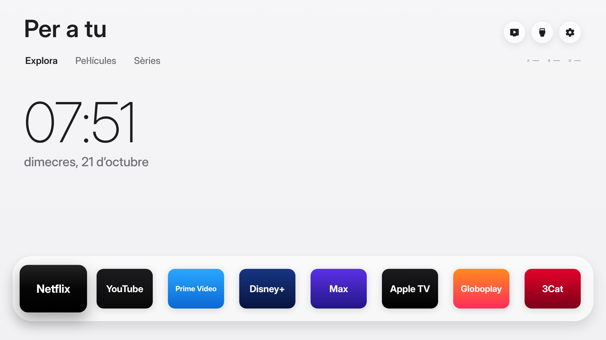
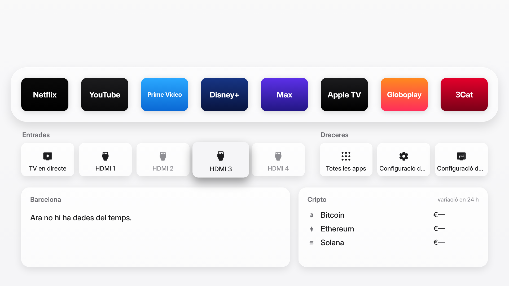
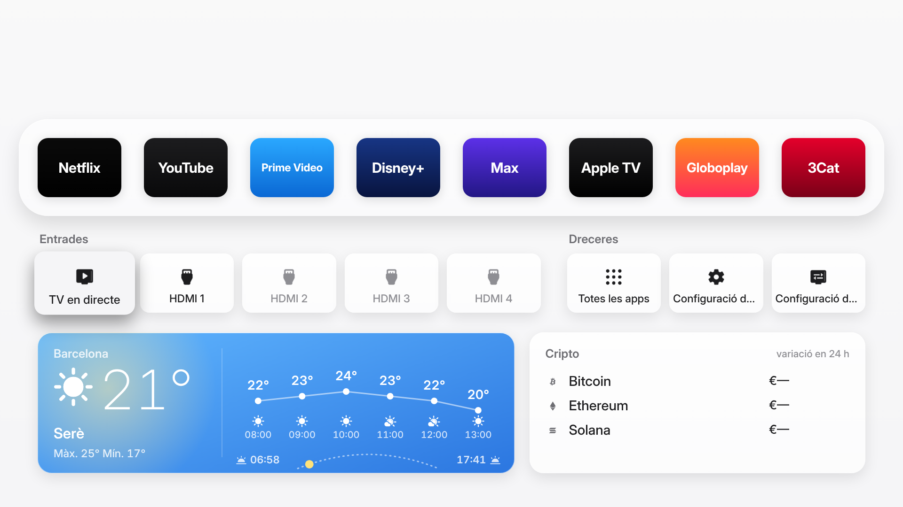
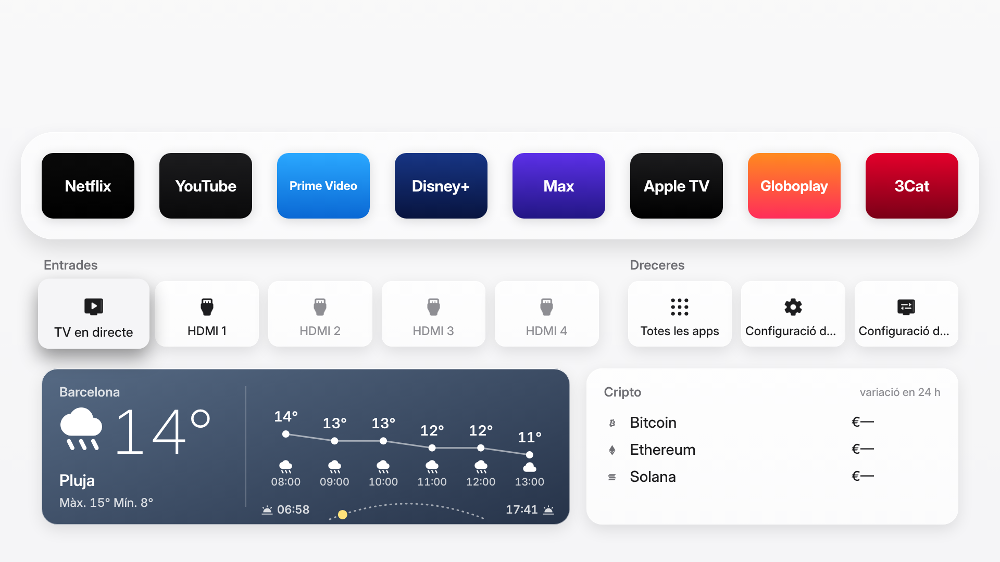
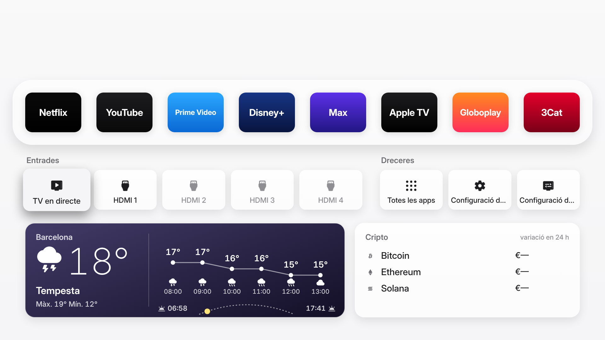

# Free My TV en català

Aquesta branca afegeix el català (`ca`) i 3Cat, Movistar Plus+ i DAZN a la prestatgeria, i una targeta del temps nova.
Les captures són de la versió web (LG/Samsung) en mode previsualització, amb apps i dades del temps d'exemple.

## Inici i calaix

## Targeta del temps: el cel que toca
Degradat segons la condició (sol, nit, núvols, pluja, tempesta, boira, neu), corba de temperatura hora a hora i el camí del sol.

