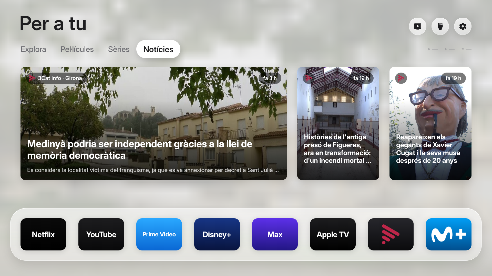
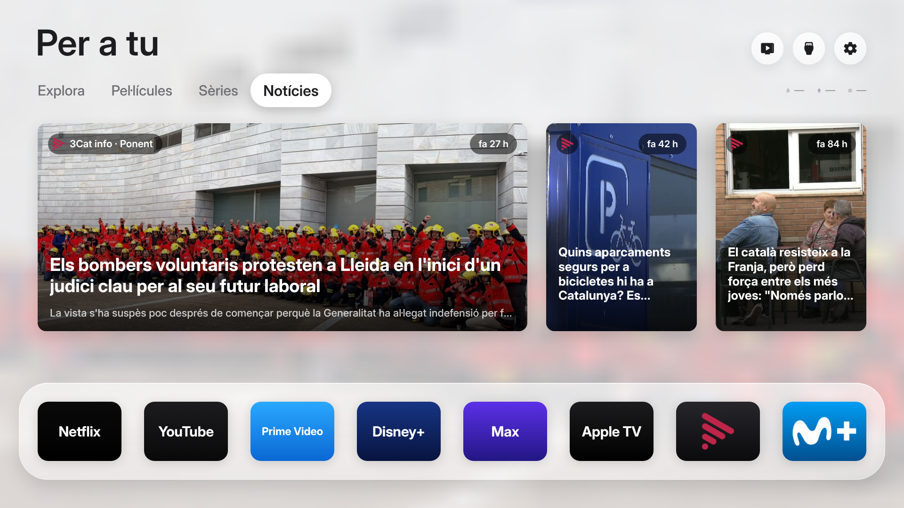
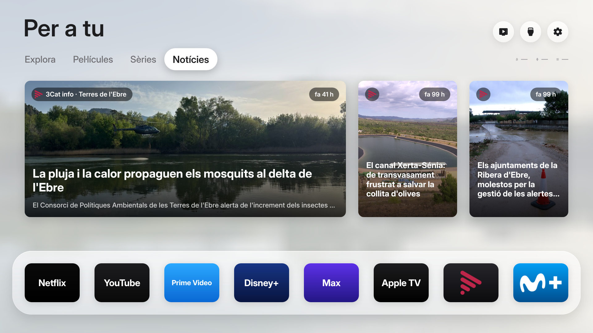
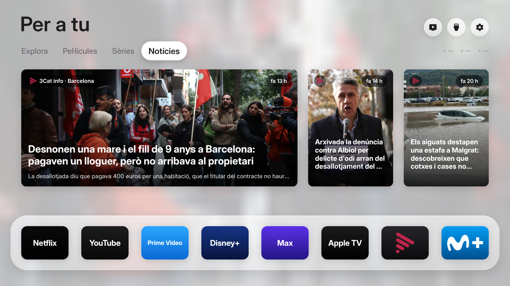
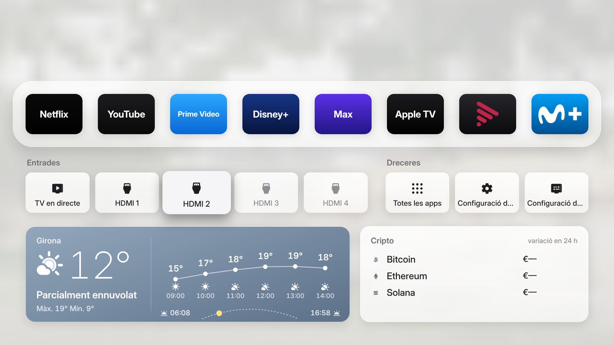

# Free My TV en català

Aquesta branca afegeix:

- **Català** (`ca`) a tota l'app (Android i versió web LG/Samsung).
- **3Cat, Movistar Plus+ i DAZN** a la prestatgeria, amb els logos oficials (`app/assets/logos/`).
- **Pestanya «Notícies»** amb les notícies de la delegació de 3Cat info que toca segons la ciutat (Barcelona, Girona, Tarragona, Ponent, Terres de l'Ebre, Alt Pirineu, Aran, Penedès i Catalunya Central), via els RSS territorials de 3Cat. Només versió web per ara.
- **Targeta del temps nova**: degradat segons el cel, corba hora a hora i camí del sol. Només versió web per ara.

Les captures són de la versió web en previsualització, amb dades reals de 3Cat info i Open-Meteo del dia de la captura.

## Notícies per zona
| Girona | Ponent (Lleida) |
|---|---|
|  |  |
|  |  |

## El temps

Altres cels (dades d'exemple):

